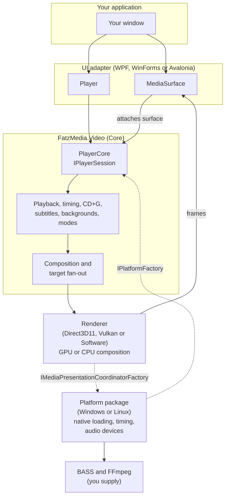

# Architecture

FatzMedia.Video is split into four kinds of package: a UI-independent Core, renderers, platform packages and UI adapters. Your application picks one of each (apart from Core) and wires them together at start-up. This page explains who owns what, so you know which package to look in for a feature and which choices you have.



## The four layers

### Core: the engine

`FatzMedia.Video` owns everything that is the same on every platform and UI:

- playback, the playback clock and A/V synchronization,
- the player state machine and the control queue that serializes your calls,
- composition policy: what layers exist (video or image, background, CD+G, subtitles, lyrics) and how they are placed,
- CD+G decoding, MIDI/KAR lyric timing, subtitle parsing, sidecar and archive background discovery,
- player modes (Full, Background, Audio),
- fan-out of the composed picture to every attached surface (a main window and a second screen),
- the contracts that renderers and platforms implement.

Core has no reference to Windows, WPF, any renderer or any platform package, and declares no `DllImport` or `LibraryImport` of its own. Its public face is <xref:FatzMedia.Video.PlayerCore>, which implements <xref:FatzMedia.Video.IPlayerSession>.

### Renderers: the final picture

A renderer takes the composed frame description from Core and turns it into pixels.

| Renderer | Package | Output | Notes |
| --- | --- | --- | --- |
| Direct3D11 | `FatzMedia.Video.Direct3D11` | Swap chain in a native window, exported GPU images, or frames for a frame sink | Subtitle and lyric text through DirectWrite. Hardware decoding with D3D11VA. HDR output. Windows only. |
| Vulkan | `FatzMedia.Video.Vulkan` | Frames for a frame sink, or exported GPU images | GPU decoding through Vulkan Video where the driver supports it. Subtitle and lyric text through SkiaSharp (`FatzMedia.Video.Text`). Windows and Linux. Preview. |
| Software | `FatzMedia.Video.Software` | Frames for a frame sink | CPU composition, deterministic output, no GPU or window. Subtitle and lyric text through SkiaSharp (`FatzMedia.Video.Text`). Any platform. |

You select a renderer by passing its factory (an <xref:FatzMedia.Video.Controllers.IMediaPresentationCoordinatorFactory>) to the platform factory. <xref:FatzMedia.Video.Controllers.FallbackPresentationCoordinatorFactory> takes several candidates and uses the first that reports itself available, for example Direct3D11, then Software.

### Platform packages: the operating system

`FatzMedia.Video.Windows` and `FatzMedia.Video.Linux` own what depends on the OS: finding and loading the BASS and FFmpeg libraries, high-resolution timing, audio output device monitoring, and the hardware-decode policy. Each provides an <xref:FatzMedia.Video.IPlatformFactory> implementation (<xref:FatzMedia.Video.WindowsPlatformFactory>, <xref:FatzMedia.Video.Linux.LinuxPlatformFactory>). A platform factory is constructed with the renderer factory, so the pair `(platform, renderer)` is chosen in one expression:

```csharp
var platform = new WindowsPlatformFactory(new SoftwarePresentationCoordinatorFactory());
```

`FatzMedia.Video.Windows.Direct3D11` is a convenience: <xref:FatzMedia.Video.WindowsDirect3D11PlatformFactory> is a Windows platform factory that already contains the Direct3D11 renderer.

### Adapters: your UI framework

The WPF, WinForms and Avalonia adapters connect Core to a UI framework. They own the surface control (`MediaSurface`: size, DPI, window handle or bitmap, input), the second-screen window, the ready-made `KaraokeSurface` and `BackgroundSurface` controls, and conversion of framework images to engine images. They own no media logic, no renderer policy and no timing.

Each adapter also has a `Player` class that derives from `PlayerCore`. It adds only an asynchronous factory (`Player.CreateAsync`) and `Load` overloads that accept the framework's image type (`ImageSource` for WPF, `Bitmap` for Avalonia and WinForms). Everything else is the Core API. See [Player and session](player-and-session.md).

## How frames reach the screen

Core composes; the renderer renders; the adapter's surface shows. There are three ways a rendered frame reaches the screen, and a surface reports which one it uses through `MediaSurface.PresentationPath` (<xref:FatzMedia.Video.MediaSurfacePresentationPath>):

| Path | What happens | Used by |
| --- | --- | --- |
| `NativeWindow` | The renderer presents straight into a child window (an HWND swap chain). Best performance. | Direct3D11 in WPF (`NativeHwndOverlay`, the default) and WinForms |
| `SharedGpuImage` | The renderer exports GPU images that the UI framework imports without copying. | Avalonia with Direct3D11 or Vulkan, when the compositor supports it |
| `FrameSink` | The renderer reads each frame back to the CPU and the surface draws it as a bitmap. | The Software renderer; Vulkan in WPF and WinForms; WPF `WpfComposited` mode; fallback everywhere |

A frame sink costs a CPU copy per frame but works with any renderer and lets WPF apply clipping, transforms and opacity to the video.

### More than one surface

One player can feed several surfaces: the control in your main window and, for example, a full-screen window on a second monitor. Each `MediaSurface` has a `Role` (`Primary` or `Projector`) and a `SurfaceId`. The renderer composes once per surface at that surface's size. Only the primary surface forwards the video display mode. The adapters provide `SecondaryPresentationWindow` for the common case. See [Second screen](../presentation/second-screen.md) and [Surfaces](../presentation/surfaces.md).

## Dependencies and choices

| Package | Depends on |
| --- | --- |
| `FatzMedia.Video.Windows` | Core |
| `FatzMedia.Video.Linux` | Core |
| `FatzMedia.Video.Direct3D11`, `.Text` | Core |
| `FatzMedia.Video.Software`, `.Vulkan` | Core, Rendering.Text |
| `FatzMedia.Video.Windows.Direct3D11` | Windows, Rendering.Direct3D11 |
| `FatzMedia.Video.Wpf` | Windows (and through it, Core) |
| `FatzMedia.Video.WinForms`, `.Avalonia` | Core |

Adapters never reference renderers, and renderers never reference adapters or platform packages. The only package that combines two others is `Windows.Direct3D11`. This is why the host chooses the combination: the adapter does not know which renderer you use, and a renderer does not know which UI shows its frames.

The consequences for you:

- A WPF, WinForms or Avalonia host can run any renderer that the platform supports.
- The same player code works on every adapter; only start-up (platform and renderer) and the surface control differ.
- You can write a UI-free host (a service, a test) with Core, a platform package and the Audio mode.
- Native libraries are loaded by the platform package, so the choice of operating system decides the file names ([Native dependencies](../getting-started/native-dependencies.md)).

## Audio

Audio output uses BASS behind an engine interface (<xref:FatzMedia.Video.Core.Abstractions.IAudioEngine>). Audio formats BASS has no add-on for fall back to FFmpeg decoding, which is played through the same BASS chain. Treat BASS as an implementation detail of the audio engine: the player API does not expose BASS types.

## What is not in scope

The library does not provide a plugin architecture, DVD or Blu-ray playback, or a playlist or media library. Your application owns its playlist; the engine offers a "prepared next" slot to make transitions quick (see [Prepared next and transitions](../playback/prepared-next-and-transitions.md)).
